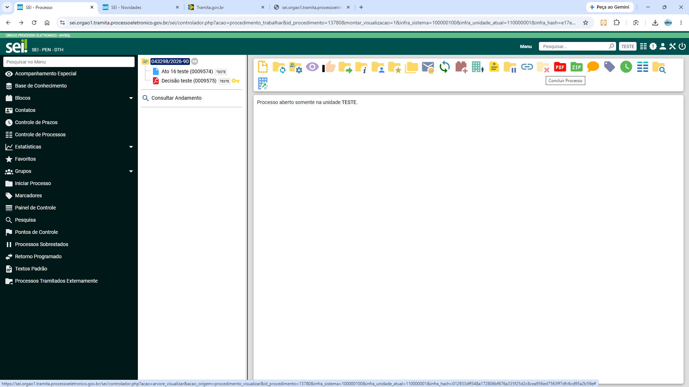
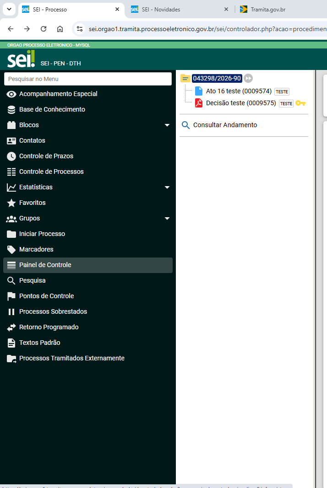
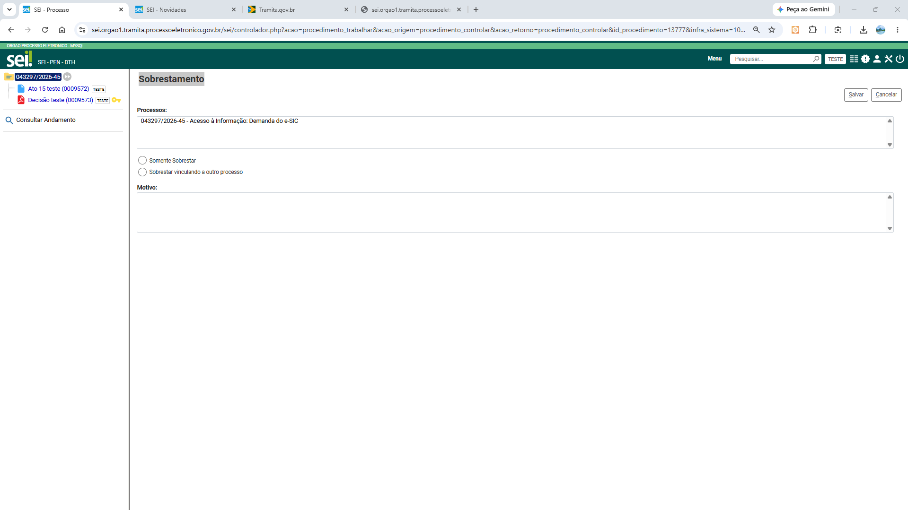
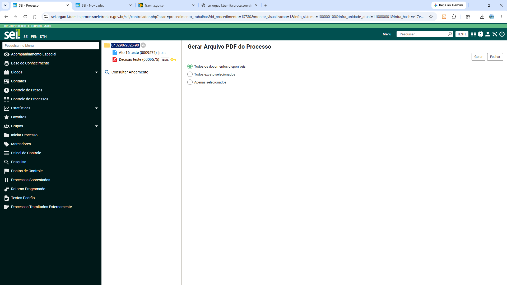

# Inventário consolidado de recursos e modelo operacional do SEI

Documento consolidado para consulta contínua no backend. O conteúdo detalhado permanece dividido nos arquivos `00` a `09`, que são as fontes editáveis desta consolidação.

> Escopo: núcleo funcional do SEI 4.0+ e recursos documentados para 4.1/5.0, acrescidos dos módulos oficiais e da infraestrutura analisada. A disponibilidade efetiva varia por versão, perfil, unidade, configuração e módulos instalados.

---
<!-- Fonte: 00-escopo-e-terminologia.md -->
## 00 — Escopo, versões e terminologia

### Escopo da análise

O Manual oficial do Usuário utilizado como referência cobre funcionalidades do **SEI 4.0+**, incluindo evoluções incorporadas nas versões **4.1 e 5.0**. A disponibilidade real de uma funcionalidade depende de quatro fatores:

1. versão instalada;
2. perfil e recursos concedidos no SIP;
3. tipo e configuração da unidade;
4. módulos habilitados pelo órgão.

Assim, a ausência de um botão na tela não prova que a instalação não possui o recurso: ele também pode estar desabilitado para o perfil ou para a unidade. De modo inverso, módulos podem acrescentar menus e botões que não pertencem ao núcleo padrão.

### Entidades conceituais

| Conceito | Significado operacional |
|---|---|
| Instalação | Uma implantação do SEI, com código, banco, repositório de arquivos e configuração próprios. |
| Órgão | Entidade administrativa existente dentro da instalação; uma instalação pode ser mono ou multiórgão. |
| Unidade | Contexto organizacional de trabalho. O usuário atua no SEI sempre dentro de uma unidade selecionada. |
| Usuário | Pessoa autenticada, vinculada a perfis e unidades pelo SIP. |
| Processo | Agregador eletrônico identificado por NUP, com metadados, documentos, andamentos e relações. |
| Documento interno | Documento criado no editor HTML do SEI, com modelo, versões e assinaturas. |
| Documento externo | Arquivo produzido fora do SEI e incluído por upload. |
| Formulário | Documento estruturado em campos definidos pelo administrador. |
| Andamento | Registro de uma ação no histórico, associado a data, unidade e usuário. |
| Processo aberto na unidade | Indica que aquela unidade possui um contexto ativo de trabalho sobre o processo. |
| Processo concluído na unidade | Indica que a unidade encerrou seu contexto ativo; não significa necessariamente que todas as outras unidades também concluíram. |
| Processo arquivado | Processo submetido a uma etapa formal de gestão documental, sem andamentos abertos e bloqueado para novos atos até desarquivamento. |

### Princípio fundamental: uma pasta compartilhada, vários contextos de trabalho

O melhor modelo mental é:

```text
                         PROCESSO ÚNICO
                 NUP + árvore + histórico comum
                              │
               ┌──────────────┼──────────────┐
               │              │              │
          Unidade A       Unidade B       Unidade C
          aberta           aberta          concluída
          marcadores A     marcadores B    sem contexto ativo
          prazo A          prazo B
          atribuição A     atribuição B
```

Não são três cópias do processo. É um processo único, acompanhado por contextos operacionais independentes por unidade.

### Dados compartilhados e dados locais

#### Compartilhados, conforme o nível de acesso

- NUP e metadados gerais;
- documentos assinados e documentos externos;
- histórico de andamentos;
- relações e anexações;
- comentários, conforme regras de acesso;
- ciência e atos formais;
- alterações globais de nível de acesso.

#### Pertencentes à unidade

- atribuição a usuário;
- anotação;
- marcador e texto do marcador;
- controle de prazo;
- acompanhamento especial;
- bloco interno;
- observação inserida pela unidade, embora outras unidades possam vê-la separadamente sem editá-la.

A matriz detalhada está em [`05-visibilidade-e-escopo-dos-dados.md`](05-visibilidade-e-escopo-dos-dados.md).

### Telas analisadas

A tela fornecida informa explicitamente **“Processo aberto somente na unidade TESTE”**, o que evidencia que o SEI apresenta as unidades abertas como uma propriedade operacional do processo:



O menu principal observado contém os principais recursos do perfil básico:



### Limites desta documentação

O código-fonte integral e privado da versão do SEI utilizada no ambiente não foi fornecido. Por isso:

- esta documentação descreve o **comportamento funcional**, não tenta reproduzir nomes exatos de tabelas ou classes privadas;
- modelos de banco apresentados como sugestão são **recomendações de arquitetura**, e não afirmações sobre a implementação interna do SEI;
- detalhes que variam por versão ou módulo estão marcados explicitamente.

### Fontes principais

- [Manual do Usuário SEI 4.0+][U0]
- [Iniciando Operações][U1]
- [Operações Básicas com Processos][U2]
- [Manual do Administrador SEI][A0]

[U0]: https://manuais.processoeletronico.gov.br/pt-br/latest/SEI/
[U1]: https://manuais.processoeletronico.gov.br/pt-br/latest/SEI/Iniciando_operacoes.html
[U2]: https://manuais.processoeletronico.gov.br/pt-br/latest/SEI/Operacoes_basicas_com_processos.html
[A0]: https://manuais.processoeletronico.gov.br/pt-br/latest/SEIADM/index.html

---

<!-- Fonte: 01-modelo-operacional-processos-e-unidades.md -->
## 01 — Modelo operacional de processos e unidades

### Resposta direta

No SEI, **“aberto” e “concluído” são condições relacionadas à unidade**, não simplesmente um único status global do processo.

Um processo pode estar:

- aberto somente na Unidade A;
- aberto simultaneamente nas Unidades A, B e C;
- concluído na Unidade A, mas aberto na Unidade B;
- sem nenhuma unidade aberta, situação normalmente chamada de processo totalmente concluído;
- posteriormente reaberto por uma unidade pela qual já tramitou.

### Como duas unidades ficam com o mesmo processo aberto

#### Caminho 1 — Envio com manutenção na origem

```text
Estado inicial
  A = aberto
  B = não aberto

A envia para B marcando “Manter processo aberto na unidade atual”

Estado final
  A = aberto
  B = recebido/aberto
```

#### Caminho 2 — Envio a várias unidades

O SEI permite informar uma ou várias unidades de destino no mesmo envio:

```text
A envia para B, C e D

A = concluída automaticamente, salvo “manter aberto”
B = recebe o processo
C = recebe o processo
D = recebe o processo
```

O manual recomenda o envio simultâneo apenas quando as atividades das unidades forem **independentes entre si**. Se a ação de C depender da produção de B, o envio paralelo pode quebrar a sequência lógica do trabalho.

#### Caminho 3 — Reabertura por unidade anterior

Uma unidade pela qual o processo já tramitou pode localizá-lo e clicar em **Reabrir Processo**, sem solicitar novo envio. A reabertura cria novamente um contexto ativo para essa unidade e atribui o processo ao usuário que executou a ação.

Isso significa que o processo pode voltar a ficar aberto em múltiplas unidades mesmo sem novo envio da unidade que já o estava tratando.

### Envio normal e conclusão automática

Por padrão:

```text
A envia para B sem marcar “Manter processo aberto”

A = concluída
B = pendente de recebimento/aberta
```

A conclusão da origem é automática. Marcar **Manter processo aberto na unidade atual** impede essa conclusão.

### O que o recebimento significa

Na unidade destinatária, o processo aparece em vermelho até que um usuário clique em seu número. O clique registra no histórico:

- data e hora do recebimento;
- unidade;
- usuário responsável.

A cor vermelha é, portanto, uma sinalização de **não recebido por usuário da unidade**, e não a criação de outra pasta ou outro NUP.

### O processo é copiado?

Não. O processo permanece único:

```text
NUP único
árvore única de documentos
histórico único
metadados de processo compartilhados
```

Cada unidade possui sua organização operacional própria. Quando uma unidade inclui e assina um novo documento, esse documento passa a compor a árvore comum, observadas as regras de acesso.

### Minutas e documentos assinados

- Documento interno não assinado continua sendo uma minuta da unidade produtora.
- Para outra unidade visualizar/editar uma minuta antes da assinatura, o mecanismo próprio é o **Bloco de Assinatura** ou o **Bloco de Reunião**, conforme a finalidade.
- Um documento assinado ainda pode ser editável enquanto não tiver sido tramitado ou visualizado por outra unidade, sinalizado pela caneta amarela.
- Depois que usuário de outra unidade acessa o documento assinado, a caneta se torna preta e sua edição deixa de ser permitida.

Esse comportamento reduz o risco de uma unidade alterar silenciosamente um documento já conhecido por outra.

### Conclusão por unidade

Considere o processo aberto em A e B:

```text
Antes
  A = aberto
  B = aberto

A clica “Concluir Processo”

Depois
  A = concluído
  B = aberto
```

A conclusão em A:

- remove o processo do Controle de Processos de A;
- encerra o tempo de permanência aberto em A;
- não remove nem bloqueia o processo em B;
- não apaga documentos;
- não equivale a arquivamento;
- não impede consulta posterior por A.

### Quando o processo está “totalmente concluído”

Operacionalmente, isso ocorre quando não existe mais nenhuma unidade com andamento aberto:

```text
unidades_abertas(processo) = conjunto vazio
```

O termo “totalmente concluído” é útil para evitar ambiguidade, pois “concluído” pode significar apenas “concluído na minha unidade”.

### Reabrir não é consultar

Uma unidade que já participou do processo pode consultá-lo por pesquisa sem reabrir. Deve reabrir somente quando precisar:

- incluir documento;
- registrar novo ato;
- enviar novamente;
- executar outra providência que exija processo aberto.

Ao reabrir, o processo volta ao Controle de Processos e é atribuído automaticamente ao usuário que o reabriu.

### Consequências estatísticas

O manual informa que o tempo durante o qual o processo permanece aberto, mesmo sem atividade, é computado como tempo de andamento da unidade. Portanto, deixar o processo aberto apenas “para acompanhar” produz indicadores distorcidos.

Para simples acompanhamento, use **Acompanhamento Especial**.

### Riscos de manter aberto em várias unidades

| Risco | Exemplo | Mitigação |
|---|---|---|
| Trabalho duplicado | A e B produzem respostas para a mesma demanda. | Definir responsabilidade no despacho e usar envio sequencial quando houver dependência. |
| Ordem documental confusa | Documentos de A e B são inseridos em paralelo. | Padronizar títulos, registrar andamentos e ordenar árvore apenas quando necessário. |
| Indicadores inflados | Unidade mantém processo aberto sem atuação. | Concluir e usar Acompanhamento Especial. |
| Decisão concorrente | Duas unidades tentam dar solução final diferente. | Definir unidade coordenadora e tarefas independentes. |
| Estado difícil de entender | Usuário conclui em A achando que encerrou todo o processo. | Exibir sempre a lista de unidades abertas e usar linguagem “Concluir nesta unidade”. |
| Propagação excessiva | Cada unidade envia para novas unidades mantendo-se aberta. | Regras de governança e auditoria de unidades abertas. |

### Ferramenta correta para cada necessidade

| Necessidade | Recurso adequado |
|---|---|
| Apenas observar futuras atualizações | Acompanhamento Especial |
| Organizar processos internos da unidade | Marcador ou Bloco Interno |
| Cobrar devolução de outra unidade | Retorno Programado |
| Compartilhar minuta para assinatura | Bloco de Assinatura |
| Compartilhar minuta para discussão, sem atuação formal | Bloco de Reunião |
| Executar tarefas paralelas independentes | Envio a múltiplas unidades ou manutenção aberta na origem |
| Suspender formalmente o trabalho | Sobrestamento |
| Encerrar a participação da unidade | Concluir Processo |
| Encerrar gestão documental e iniciar guarda | Arquivar Processo, quando habilitado |

### Filtro “Linha Direta”

Quando várias unidades trabalham no mesmo processo, o filtro **Linha Direta** pode exibir somente documentos produzidos por unidades que enviaram o processo diretamente para a unidade atual ou o receberam diretamente dela. Esse filtro não exclui documentos; apenas reduz a árvore visualizada. Pode causar a falsa impressão de que unidades diferentes possuem versões distintas da pasta.

### Modelo conceitual recomendado para uma reimplementação

> Recomendação de arquitetura; não representa necessariamente as tabelas privadas do SEI.

```text
processo
  id
  nup
  tipo
  nivel_acesso
  ...

processo_unidade
  id_processo
  id_unidade
  situacao: PENDENTE_RECEBIMENTO | ABERTO | CONCLUIDO
  data_envio
  data_recebimento
  data_abertura
  data_conclusao
  id_usuario_recebimento
  id_usuario_conclusao
  origem_do_envio

andamento
  id_processo
  id_unidade
  id_usuario
  tipo_evento
  data_hora
  descricao
```

#### Invariantes úteis

1. Um processo possui no máximo um contexto ativo por unidade.
2. Concluir A nunca altera automaticamente B, C ou D.
3. Enviar sem manter aberto conclui somente o contexto remetente.
4. Reabrir exige que a unidade tenha vínculo histórico ou permissão equivalente.
5. A ausência de unidades abertas não apaga nem arquiva o processo.
6. Arquivamento só pode ocorrer sem contextos abertos.
7. Dados locais da unidade não são copiados para a unidade destinatária.

### Exemplo completo

```text
09:00 — A inicia o processo
         abertas = {A}

10:00 — A envia para B mantendo aberto
         abertas = {A, B}

11:00 — B recebe
         abertas = {A, B}

14:00 — A conclui sua parte
         abertas = {B}

15:00 — B envia para C sem manter aberto
         abertas = {C}

16:00 — C conclui
         abertas = {}
         condição operacional: totalmente concluído

Dia seguinte — A reabre para correção
         abertas = {A}
```

### Fontes principais

- [Operações Básicas com Processos][U2]
- [Iniciando Operações — Tela do Processo][U1]
- [Operações Básicas com Documentos][U5]
- [Blocos][U7]

[U1]: https://manuais.processoeletronico.gov.br/pt-br/latest/SEI/Iniciando_operacoes.html
[U2]: https://manuais.processoeletronico.gov.br/pt-br/latest/SEI/Operacoes_basicas_com_processos.html
[U5]: https://manuais.processoeletronico.gov.br/pt-br/latest/SEI/Operacoes_basicas_com_documentos.html
[U7]: https://manuais.processoeletronico.gov.br/pt-br/latest/SEI/Blocos.html

---

<!-- Fonte: 02-inventario-recursos-usuario.md -->
## 02 — Inventário de recursos do usuário

Este inventário cobre os recursos documentados no Manual do Usuário SEI 4.0+, incluindo funções incorporadas nas versões 4.1 e 5.0. A presença em tela depende de versão, perfil, unidade e módulos.

### 1. Acesso, navegação e organização da tela

| Recurso | Para que serve | Vantagens | Limitações e comportamento |
|---|---|---|---|
| Login | Autenticar o usuário e carregar seus perfis e unidades. | Centraliza identidade e auditoria. | O que o usuário enxerga depende das permissões do SIP. |
| Autenticação em dois fatores | Adicionar código temporário ao login. | Reduz risco de comprometimento por senha. | Depende de ativação e dispositivo/aplicativo autenticador. |
| Troca de unidade | Alternar o contexto organizacional do usuário. | Um usuário pode trabalhar em mais de uma unidade sem outra conta. | Todas as ações são registradas na unidade selecionada; trocar de unidade não transfere processo. |
| Menu principal | Acessar recursos do perfil e da unidade. | Entrada central para operações. | O menu é dinâmico e não representa todos os recursos existentes na instalação. |
| Controle de Processos | Exibir processos abertos recebidos e gerados na unidade. | Visão operacional e ações em lote. | Não mostra automaticamente processos concluídos, arquivados ou apenas acompanhados. |
| Painel de Controle | Resumir processos abertos, prazos, retornos, blocos, tipos, marcadores, atribuições e acompanhamentos. | Visão gerencial configurável. | É um painel da unidade; não substitui relatórios ou gestão de workflow. |
| Painel em Números | Exibir indicadores compactos, a partir do SEI 4.1. | Leitura rápida. | Detalhamento depende da configuração da unidade. |
| Atalhos de acessibilidade | Navegar entre tela, menu, árvore, pesquisa e editor pelo teclado. | Melhora acessibilidade e produtividade. | Alguns atalhos dependem do foco da tela/navegador. |
| Favoritos de processo | Criar atalho de acesso rápido ao processo. | Facilita localizar processos recorrentes. | Não duplica nem transforma o processo em modelo. |

### 2. Ciclo básico do processo

| Recurso | Para que serve | Vantagens | Limitações e comportamento |
|---|---|---|---|
| Iniciar Processo | Criar um novo processo e gerar NUP. | Padroniza tipo, assuntos, acesso e metadados. | Depende dos tipos de processo habilitados para órgão/unidade. |
| Receber Processo | Confirmar que usuário da unidade acessou o processo recebido. | Registra data, hora, unidade e usuário. | Processo aparece em vermelho até o recebimento. |
| Consultar/Alterar Processo | Consultar ou modificar descrição, interessados, destinatário, nível de acesso e observações. | Mantém metadados atualizados e pesquisáveis. | NUP e data de autuação não são livremente alteráveis; observações de outra unidade não podem ser editadas. |
| Atribuir Processo | Associar processo a usuário da unidade. | Distribui responsabilidade interna. | Não impede outros usuários da mesma unidade de atuar; não é visível a outras unidades. |
| Enviar Processo | Tramitar para uma ou várias unidades. | Permite fluxo sequencial ou paralelo. | Conclui a origem automaticamente, salvo “Manter aberto”; múltiplos destinos devem ter tarefas independentes. |
| Manter processo aberto na unidade atual | Preservar contexto ativo na origem durante o envio. | Permite trabalho paralelo legítimo. | Inflaciona tempo estatístico e aumenta risco de atuação duplicada se usado sem governança. |
| Atualizar Andamento | Registrar informação no histórico sem criar documento formal. | Registro rápido de evento operacional. | Não deve substituir despacho/decisão quando a informação precisar integrar formalmente os autos. |
| Ciência | Registrar que uma unidade tomou ciência. | Evita criar documento apenas para declarar ciência. | É um registro de ciência, não aprovação nem manifestação de mérito. |
| Concluir Processo | Encerrar o trabalho na unidade atual. | Retira da fila ativa e encerra tempo aberto naquela unidade. | Não conclui outras unidades; não arquiva; pode ser reaberto. |
| Reabrir Processo | Reativar processo anteriormente concluído na unidade. | Dispensa novo envio para unidade pela qual já tramitou. | Deve ser usado apenas para nova providência; atribui automaticamente ao usuário que reabriu. |
| Reabertura Programada | Programar reabertura na origem após envio, quando disponível. | Automatiza retorno do processo à fila da unidade em data/prazo. | Não aparece quando a origem foi mantida aberta; não equivale a Retorno Programado. |

### 3. Prazo, acompanhamento e organização interna

| Recurso | Para que serve | Vantagens | Limitações e comportamento |
|---|---|---|---|
| Controle de Prazos | Definir data ou prazo em dias para controle interno. | Agenda interna com indicação de prazo restante/vencido. | Só a unidade vê; concluir o controle não conclui o processo. |
| Retorno Programado | Definir prazo para outra unidade devolver o processo. | Cria controle bilateral de “aguardando retorno” e “para devolver”. | Não devolve automaticamente nem remove acesso no vencimento. |
| Acompanhamento Especial | Acompanhar atualizações mesmo sem manter o processo aberto. | Evita filas e estatísticas infladas; aceita grupos e observações. | É ferramenta de acompanhamento da unidade, não ato processual. |
| Marcadores | Etiquetar processos por cor, nome e texto. | Organização visual flexível. | Interno à unidade; não é transmitido no envio. |
| Anotações | Registrar orientação interna que não deve constar dos autos. | Comunicação rápida dentro da equipe. | Outra unidade não vê; não deve conter decisão formal. |
| Comentários | Registrar comentário em processo ou documento. | Comunicação contextual visível às unidades autorizadas. | Não integra a instrução processual; comentário em documento não assinado fica local até assinatura. |
| Bloco Interno | Agrupar processos semelhantes dentro da unidade. | Organização persistente e acompanhamento posterior. | Visível apenas à unidade; inclusão exige processo aberto na unidade. |
| Ponto de Controle | Atribuir fase/categoria de acompanhamento definida pela administração. | Permite indicadores e gráficos por etapa. | Não é motor de workflow obrigatório; depende de configuração por tipo de processo. |
| Plano de Trabalho | Sequenciar atividades previstas dentro do processo, disponível a partir da versão 4.1. | Organiza etapas, situações e documentos esperados. | Depende de planos administrativamente configurados; não substitui regras jurídicas do processo. |
| Estatísticas da Unidade | Medir quantidade e tempo de processos. | Apoia gestão de desempenho. | Permanência aberta sem atividade é contabilizada; qualidade depende do uso correto de concluir. |
| Desempenho de Processos | Comparar quantidade e tempo médio por tipo. | Visão por tipologia. | Indicador pode ser distorcido por processos mantidos abertos sem necessidade. |
| Relatório de Atividades | Consultar atividades de usuário/unidade, a partir do SEI 4.1. | Auditoria operacional e gestão. | Não substitui log técnico nem auditoria completa. |

### 4. Relações e situações especiais do processo

| Recurso | Para que serve | Vantagens | Limitações e comportamento |
|---|---|---|---|
| Relacionar Processos | Criar vínculo virtual entre processos. | Mantém NUPs, árvores e andamentos independentes. | Relação não funde documentos nem torna um processo subordinado ao outro. |
| Anexar Processo | Incorporar permanentemente um processo a outro. | Consolida processos cuja continuidade deve ocorrer no principal. | Ação normalmente irreversível pelo usuário; exige processo aberto apenas na unidade e impede novas alterações no anexado. |
| Duplicar Processo | Criar novo processo a partir de documentos de outro. | Reutiliza estrutura e conteúdo. | Gera outro NUP; não mantém identidade nem sincronização com o original. |
| Sobrestar Processo | Suspender temporariamente o trâmite para aguardar providência. | Retira da fila comum e registra motivo/vínculo. | Não é conclusão nem arquivo; deve haver fundamento e posterior remoção do sobrestamento. |
| Processos Sobrestados | Listar e administrar processos suspensos na unidade. | Centraliza acompanhamento da suspensão. | Só representa sobrestamentos da unidade/contexto aplicável. |
| Excluir Processo | Excluir processo gerado indevidamente, dentro das regras do sistema. | Corrige autuação indevida. | Fortemente limitado; processos com tramitação/documentos/atos geralmente não podem ser simplesmente eliminados. |
| Filtro Linha Direta | Mostrar apenas documentos de unidades com comunicação direta com a unidade atual. | Reduz ruído em processos muito distribuídos. | Oculta parte da árvore sem excluir; pode gerar interpretação errada se o usuário esquecer que o filtro está ativo. |

### 5. Documentos

| Recurso | Para que serve | Vantagens | Limitações e comportamento |
|---|---|---|---|
| Incluir Documento Interno | Criar documento HTML no editor do SEI. | Modelos, variáveis, versões e assinatura integradas. | Não é DOCX; fidelidade e recursos de layout são menores que editores de escritório completos. |
| Incluir Documento Externo | Inserir arquivo produzido fora do sistema. | Preserva documento recebido/produzido em outra ferramenta. | Extensão e tamanho dependem da configuração; conteúdo pode não ser pesquisável sem texto/OCR. |
| Formulário do Sistema | Criar documento estruturado por campos. | Validação, máscaras, listas e obrigatoriedade. | Layout visual é limitado; não serve bem para documentos de aparência complexa. |
| Editar Conteúdo | Produzir ou alterar minuta no editor. | Controle de versão e estilos institucionais. | Documento assinado e já conhecido por outra unidade deixa de ser editável. |
| Versões do Documento | Registrar e comparar alterações. | Rastreabilidade da minuta. | Não substitui versionamento de arquivos externos nem controle de mudança de um editor colaborativo em tempo real. |
| Assinar Documento | Aplicar assinatura por senha ou certificado digital. | Autenticidade, autoria e integridade. | Cargo/função e permissão precisam estar configurados; assinatura não corrige conteúdo inadequado. |
| Consultar Assinaturas | Ver assinantes e dados de autenticação. | Verificação rápida. | Validade jurídica depende do tipo de assinatura e da cadeia de validação aplicável. |
| Excluir Documento | Retirar documento incluído indevidamente quando as regras permitem. | Corrige erro antes de consolidação/tramitação. | Pode ser bloqueado após assinatura, acesso externo, tramitação ou outras dependências. |
| Cancelar Documento | Tornar documento sem efeito preservando seu registro. | Mantém rastreabilidade. | Documento cancelado não é convertido no PDF do processo; cancelamento não deve apagar a história. |
| Mover Documento Externo | Transferir documento externo para outro processo. | Corrige protocolo em pasta errada. | Documentos internos gerados no SEI não são movidos; podem ser referenciados. |
| Ordenar Árvore | Alterar ordem visual dos documentos. | Melhora compreensão quando cronologia de inclusão ficou inadequada. | Não muda datas nem histórico; uso excessivo pode ocultar a sequência real de produção. |
| Referenciar Processo/Documento | Inserir link interno em outro documento. | Evita duplicação e mantém navegação. | O acesso continua sujeito às permissões do item referenciado. |
| Favorito de Documento | Salvar documento inteiro como modelo de conteúdo. | Reutiliza formato e texto de um documento anterior. | A cópia futura é independente; alterações não voltam ao original. |
| Texto Padrão/AutoTexto | Reutilizar fragmento editável em documentos e e-mails. | Padronização e produtividade. | Não representa documento completo nem regra de negócio; precisa de manutenção textual. |
| Publicar/Agendar Publicação | Preparar publicação em veículo configurado e, quando cabível, agendar data. | Integra produção documental e publicidade oficial. | Depende de veículo, permissões e configuração; agendar não garante publicação externa sem integração adequada. |
| Autenticar Documento Externo | Registrar autenticação de documento digitalizado. | Identifica conferência com original/cópia. | Aplicável a documentos externos digitalizados e dentro das regras da unidade protocolizadora. |
| Circular | Gerar documentos semelhantes para vários destinatários/contatos. | Automatiza comunicação em massa com personalização. | Qualidade depende do cadastro de contatos; pode gerar grande quantidade de documentos. |
| Imprimir Web | Imprimir documento produzido no editor. | Saída rápida. | Disponível para documentos internos do editor, não para qualquer anexo externo. |

### 6. Colaboração e compartilhamento

| Recurso | Para que serve | Vantagens | Limitações e comportamento |
|---|---|---|---|
| Bloco de Assinatura | Disponibilizar minutas para edição/assinatura por outra unidade ou assinatura em lote. | Evita tramitar o processo só para colher assinatura. | Deve ser devolvido/cancelado/concluído corretamente; não transfere responsabilidade formal pelo processo. |
| Bloco de Reunião | Disponibilizar processos e minutas para conhecimento/discussão. | Permite ver documentos não assinados sem atuação formal. | Não autoriza atos de tramitação; é ambiente temporário de consulta. |
| Enviar Correspondência Eletrônica | Enviar e-mail relacionado ao processo, com anexos. | Mantém registro de comunicação no contexto do processo. | Entrega depende do SMTP; e-mail não substitui trâmite ou documento formal quando exigido. |
| Gerenciar Acesso Externo | Liberar consulta a usuário externo por link/autorização. | Compartilha documentos sem criar usuário interno. | Deve limitar prazo e conteúdo; envolve dados pessoais e regras de sigilo. |
| Assinatura Externa | Permitir que usuário externo assine documento. | Formaliza participação de fornecedores, advogados e interessados. | Exige cadastro/liberação e definição precisa do escopo de visualização. |
| Grupos de Contatos | Reunir contatos cadastrados. | Seleção em massa de pessoas/entidades. | Não cria permissões nem unidade de trabalho. |
| Grupos de E-mail | Reunir endereços para mensagens. | Comunicação em massa. | Não é lista de acesso ao processo. |
| Grupos de Envio | Reunir unidades para tramitação. | Agiliza envio a várias unidades. | Deve ser usado apenas quando as tarefas forem adequadamente paralelas. |

### 7. Pesquisa, conhecimento e exportação

| Recurso | Para que serve | Vantagens | Limitações e comportamento |
|---|---|---|---|
| Pesquisa Rápida | Localizar NUP, protocolo ou termo simples. | Acesso direto e rápido. | Resultados sujeitos a nível de acesso e tempo de indexação. |
| Pesquisa Estruturada | Combinar filtros de órgão, unidade, assunto, contato, assinatura, datas e texto. | Recuperação precisa. | Qualidade depende de metadados bem preenchidos e índice atualizado. |
| Pesquisar no Processo | Localizar termo dentro de processo volumoso. | Reduz navegação manual. | Minutas de outra unidade e arquivos sem texto/OCR podem não ser localizados. |
| Histórico/Consultar Andamento | Consultar ações, data, unidade e usuário. | Rastreabilidade operacional. | Atualização de andamento textual não equivale a documento formal assinado. |
| Base de Conhecimento | Descrever procedimento associado a tipos de processo, com versões, links e referências. | Preserva conhecimento institucional e orienta execução. | Não executa o fluxo automaticamente; conteúdo desatualizado pode induzir erro. |
| Gerar PDF | Consolidar documentos selecionados em PDF. | Facilita consulta, download e compartilhamento. | Operação imediata pode ser pesada; formatos não convertíveis, cancelados e minutas de outras unidades são excluídos. |
| Gerar ZIP | Baixar documentos selecionados em pacote. | Preserva arquivos originais e diferentes formatos. | Pode gerar arquivo grande; não cria uma representação visual consolidada. |
| Lixeira, desde 5.0 | Disponibilizar temporariamente conteúdo excluído/cancelado ao próprio autor da ação. | Recuperação operacional limitada. | Não é arquivo permanente nem recuperação irrestrita; depende de retenção/limpeza. |

### 8. O que não deve ser confundido

| Não confundir | Diferença |
|---|---|
| Concluir processo × concluir controle de prazo | O primeiro fecha o contexto da unidade; o segundo marca apenas o lembrete como cumprido. |
| Controle de prazo × Retorno Programado | O primeiro é interno; o segundo estabelece prazo de devolução entre unidades. |
| Acompanhamento Especial × manter processo aberto | Acompanhamento observa sem manter contexto ativo; manter aberto continua contando tempo. |
| Comentário × despacho | Comentário não integra a instrução; despacho é documento formal. |
| Relação × anexação | Relação mantém processos independentes; anexação incorpora permanentemente um ao outro. |
| Favorito de processo × favorito de documento | Processo favorito é atalho; documento favorito é modelo de conteúdo. |
| Texto Padrão × modelo do Editor | Texto padrão é fragmento; modelo define estrutura institucional do documento. |
| Conclusão × arquivamento | Conclusão encerra trabalho da unidade; arquivo inicia gestão de guarda e bloqueia novos atos. |

### Fontes principais

- [Iniciando Operações][U1]
- [Operações Básicas com Processos][U2]
- [Operações de Manutenção e Acompanhamento][U3]
- [Outras Operações com Processos][U4]
- [Operações Básicas com Documentos][U5]
- [Outras Operações com Documentos][U6]
- [Blocos][U7]
- [Acompanhando e Recuperando Informações][U8]

[U1]: https://manuais.processoeletronico.gov.br/pt-br/latest/SEI/Iniciando_operacoes.html
[U2]: https://manuais.processoeletronico.gov.br/pt-br/latest/SEI/Operacoes_basicas_com_processos.html
[U3]: https://manuais.processoeletronico.gov.br/pt-br/latest/SEI/Operacoes_de_manutencao_e_acompanhamento_de_processos.html
[U4]: https://manuais.processoeletronico.gov.br/pt-br/latest/SEI/Outras_operacoes_com_processos.html
[U5]: https://manuais.processoeletronico.gov.br/pt-br/latest/SEI/Operacoes_basicas_com_documentos.html
[U6]: https://manuais.processoeletronico.gov.br/pt-br/latest/SEI/Outras_operacoes_com_documentos.html
[U7]: https://manuais.processoeletronico.gov.br/pt-br/latest/SEI/Blocos.html
[U8]: https://manuais.processoeletronico.gov.br/pt-br/latest/SEI/Acompanhando_e_recuperando_informacoes_de_processos.html

---

<!-- Fonte: 03-documentos-modelos-contatos-grupos-e-blocos.md -->
## 03 — Documentos, modelos, contatos, grupos e blocos

### 1. Tipos de conteúdo documental

#### Documento interno

É produzido no editor HTML do próprio SEI. O tipo documental define o modelo, a numeração, o grupo e se poderá ser usado como interno, externo ou ambos.

**Vantagens**

- integração nativa com assinaturas;
- variáveis institucionais;
- histórico de versões;
- estilos padronizados;
- pesquisa textual direta;
- tarjas de assinatura e autenticação.

**Limitações**

- não é um arquivo DOCX;
- recursos de paginação, tabelas e layout são mais limitados que Word/LibreOffice;
- a aparência depende dos modelos HTML e estilos administrados;
- edição concorrente em tempo real não é o objetivo do editor.

#### Documento externo

É um arquivo enviado por upload. As extensões autorizadas são configuradas pelo administrador.

**Vantagens**

- preserva o formato recebido;
- aceita PDF, imagens e outros formatos habilitados;
- permite registrar remetente, data, número, autenticidade e nível de acesso.

**Limitações**

- pesquisa de conteúdo depende de texto extraível ou OCR;
- tamanho e extensão são limitados por parâmetros;
- conversão para PDF depende do formato e dos serviços disponíveis;
- não possui o mesmo modelo de versões do documento interno.

#### Formulário do sistema

Documento composto por campos configuráveis:

- data;
- dinheiro;
- lista;
- inteiro e decimal;
- texto simples/grande;
- texto com máscara;
- opções;
- sinalizadores;
- informações fixas.

**Vantagem:** dados estruturados, validados e consistentes.

**Limitação oficial:** o recurso não permite livre formatação do layout; não é indicado quando a aparência do documento é requisito central.

### 2. Quatro mecanismos que parecem “modelo”, mas são diferentes

| Mecanismo | Escopo | O que reutiliza | Quando usar | Limitação principal |
|---|---|---|---|---|
| Modelo do Editor | Institucional/administrativo | Estrutura: cabeçalho, título, corpo, assinatura, rodapé, estilos e variáveis | Padronizar tipos documentais oficiais | Exige administração e frequentemente conhecimento de HTML. |
| Documento Favorito | Unidade | Conteúdo e formato integral de um documento anterior | Repetir minuta semelhante | A cópia é independente e pode carregar conteúdo desatualizado. |
| Texto Padrão | Unidade | Fragmento de texto editável | Cláusulas, parágrafos e respostas recorrentes | Não define documento completo nem validações. |
| Base de Conhecimento | Associada a tipo de processo | Instrução de trabalho, referências, links e PDF | Explicar como executar o processo | Orienta pessoas, mas não automatiza etapas. |

#### Modelo do Editor

Administradores configuram:

- modelos;
- seções do modelo;
- estilos;
- tarjas de assinatura/autenticação;
- formatos de imagem permitidos.

Uma seção pode ser dinâmica, somente leitura, cabeçalho, corpo, assinatura ou rodapé. Variáveis como sigla do órgão/unidade são substituídas pelo sistema.

#### Documento Favorito

Salvar um documento nos Favoritos permite utilizá-lo como modelo de um novo documento. O novo conteúdo pode ser editado sem alterar o documento de origem.

Um processo também pode ser favorito, mas apenas como atalho; ele não vira um “modelo de processo”.

#### Texto Padrão

É um fragmento editável que pode ser inserido:

- na criação de documento;
- pelo AutoTexto dentro do editor;
- em e-mails produzidos no SEI.

Pode usar variáveis do sistema. Deve ter responsável pela manutenção para evitar textos normativos desatualizados.

#### Base de Conhecimento

É associada a um ou mais tipos de processo e pode conter:

- descrição das etapas;
- legislação;
- links de intranet/internet;
- referências a documentos/processos;
- PDF complementar;
- versões liberadas.

A unidade autora prepara nova versão e a libera. Usuários podem pesquisar por palavras-chave e acessar a base associada ao tipo do processo.

### 3. Contatos

Contatos são entidades usadas nos metadados e comunicações do SEI, como:

- interessado do processo;
- remetente de documento externo;
- destinatário;
- usuário externo;
- destinatário de circular ou e-mail.

O cadastro administrativo pode usar classificações correlacionadas:

- tipo de contato;
- categoria;
- cargo;
- título;
- tratamento;
- vocativo.

#### Benefícios

- padroniza nomes e dados;
- melhora pesquisa;
- permite geração de circulares e comunicações;
- evita digitação repetida.

#### Limitações e riscos

- duplicidade de contatos prejudica pesquisa e relatórios;
- cadastro desatualizado gera documentos e e-mails incorretos;
- contato não é usuário nem permissão;
- um contato não recebe acesso ao processo automaticamente.

### 4. Grupos

#### Grupo de Contatos

Agrupa contatos cadastrados. Serve para selecionar pessoas/entidades em lote.

#### Grupo de E-mail

Agrupa endereços eletrônicos. Serve para envio de mensagens.

#### Grupo de Envio

Agrupa unidades administrativas. Serve para enviar processos a diversas unidades sem selecioná-las uma a uma.

#### Grupo de Blocos

Organiza blocos de assinatura, reunião ou internos, conforme a tela e o contexto.

#### Grupos institucionais e grupos locais

A administração pode criar grupos institucionais reutilizáveis pelo órgão. Usuários/unidades também podem ter grupos operacionais conforme permissões. A disponibilidade exata depende da configuração.

#### O que grupos não fazem

- não concedem perfil;
- não atribuem processo a pessoas;
- não criam uma unidade;
- não tornam contatos usuários;
- não implementam workflow;
- não garantem que tarefas paralelas sejam adequadas.

### 5. Blocos

#### Bloco de Assinatura

Disponibiliza minutas para usuários de outras unidades ou agrupa documentos para assinatura em lote.

Permite à unidade destinatária:

- visualizar a minuta;
- editar enquanto não houver assinatura;
- consultar o processo;
- assinar individualmente ou em lote;
- devolver o bloco.

**Vantagem:** colher assinatura sem tramitar formalmente o processo.

**Limitação:** bloco não transfere a responsabilidade pelo processo. O processo pode continuar aberto somente na unidade de origem.

#### Bloco de Reunião

Disponibiliza processos para conhecimento/discussão de outra unidade, permitindo visualizar minutas não assinadas sem atuação formal.

**Vantagem:** apoio a reunião e decisão colegiada.

**Limitação:** não equivale a envio e não autoriza a unidade receptora a executar atos processuais normais.

#### Bloco Interno

Agrupa processos relacionados para organização da unidade e permite acompanhar atualizações posteriores de processos públicos ou restritos que já tramitaram nela.

**Vantagem:** organização temática ou por carteira de trabalho.

**Limitações:**

- só a unidade criadora vê;
- o processo precisa estar aberto na unidade para ser incluído inicialmente;
- não substitui Acompanhamento Especial quando o objetivo é apenas acompanhar um processo fora da unidade.

### 6. Escolha rápida

| Necessidade | Recurso |
|---|---|
| Criar padrão institucional de ofício | Modelo do Editor + Tipo de Documento |
| Reaproveitar um ofício anterior | Documento Favorito |
| Inserir cláusula recorrente | Texto Padrão/AutoTexto |
| Explicar o procedimento de contratação | Base de Conhecimento |
| Coletar dados estruturados | Formulário do Sistema |
| Obter assinatura de outra unidade sem enviar processo | Bloco de Assinatura |
| Mostrar minuta para reunião | Bloco de Reunião |
| Agrupar processos da carteira da equipe | Bloco Interno/Marcador |
| Enviar processo para várias unidades | Grupo de Envio, com cautela sobre paralelismo |
| Enviar circular a muitas pessoas | Grupo de Contatos + Circular |

### 7. Implicações para uma nova implementação

> Recomendações de arquitetura.

- Separar claramente **template institucional**, **modelo favorito**, **snippet** e **procedimento de conhecimento**.
- Versionar modelos e textos padrão.
- Evitar copiar dados de contato sem chave estável; aplicar deduplicação.
- Tratar grupos como listas de seleção, não como ACL.
- Modelar bloco como compartilhamento temporário com estado: rascunho, disponibilizado, recebido, devolvido, concluído.
- Impedir edição de documento assinado após ciência/acesso por outra unidade, preservando integridade.

### Fontes principais

- [Operações Básicas com Documentos][U5]
- [Outras Operações com Documentos][U6]
- [Blocos][U7]
- [Base de Conhecimento][U8]
- [Editor — Administração][A4]
- [Tipos de Documento][A5]
- [Tipos de Formulários][A7]
- [Contatos][A8]
- [Grupos Institucionais][A9]

[U5]: https://manuais.processoeletronico.gov.br/pt-br/latest/SEI/Operacoes_basicas_com_documentos.html
[U6]: https://manuais.processoeletronico.gov.br/pt-br/latest/SEI/Outras_operacoes_com_documentos.html
[U7]: https://manuais.processoeletronico.gov.br/pt-br/latest/SEI/Blocos.html
[U8]: https://manuais.processoeletronico.gov.br/pt-br/latest/SEI/Acompanhando_e_recuperando_informacoes_de_processos.html
[A4]: https://manuais.processoeletronico.gov.br/pt-br/latest/SEIADM/Administracao_sei/Man_Adm_SEI_04-Administra%C3%A7%C3%A3o_SEI-06_Editor.html
[A5]: https://manuais.processoeletronico.gov.br/pt-br/latest/SEIADM/Administracao_sei/Man_Adm_SEI_04-Administra%C3%A7%C3%A3o_SEI-07_Tipo_de_Documento.html
[A7]: https://manuais.processoeletronico.gov.br/pt-br/latest/SEIADM/Administracao_sei/Man_Adm_SEI_04-Administra%C3%A7%C3%A3o_SEI-18_Tipos_de_Formul%C3%A1rios.html
[A8]: https://manuais.processoeletronico.gov.br/pt-br/latest/SEIADM/Administracao_sei/Man_Adm_SEI_04-Administra%C3%A7%C3%A3o_SEI-02_Contatos.html
[A9]: https://manuais.processoeletronico.gov.br/pt-br/latest/SEIADM/Administracao_sei/Man_Adm_SEI_04-Administra%C3%A7%C3%A3o_SEI-13_Grupos_Institucionais.html

---

<!-- Fonte: 04-conclusao-sobrestamento-arquivamento-e-estados.md -->
## 04 — Conclusão, sobrestamento, arquivamento e estados

### 1. “Concluído” é um status do processo?

A resposta mais precisa é:

> **A conclusão é uma situação operacional por unidade, e não necessariamente um estado global único do processo.**

O botão da tela é descrito oficialmente como **“Concluir processo nesta unidade”**. Na imagem analisada, o processo está aberto somente na unidade TESTE:


Se o mesmo processo estivesse aberto também em outra unidade, concluir na TESTE encerraria apenas a participação da TESTE.

#### Três expressões úteis

| Expressão | Significado recomendado |
|---|---|
| Aberto na unidade | A unidade possui contexto ativo de trabalho. |
| Concluído na unidade | A unidade encerrou seu contexto, mas outras podem continuar abertas. |
| Totalmente concluído | Não há nenhuma unidade com andamento aberto. |

Essa distinção evita tratar “concluído” como um booleano global simples.

### 2. O que Concluir Processo faz

- encerra as providências da unidade atual;
- remove o processo da tela Controle de Processos daquela unidade;
- registra a conclusão no histórico;
- interrompe a contagem de permanência aberta na unidade;
- mantém consulta por pesquisa, estatística ou acompanhamento;
- não apaga documentos;
- não cancela o processo;
- não arquiva;
- não conclui outras unidades.

### 3. O que Reabrir Processo faz

- cria novamente contexto ativo na unidade;
- coloca o processo de volta no Controle de Processos;
- atribui o processo ao usuário que reabriu;
- pode ser executado por unidade na qual o processo já tramitou;
- não exige novo envio apenas para reativar a unidade anterior.

Consultar processo concluído não exige reabertura. Reabrir deve significar “voltarei a praticar atos”.

### 4. Sobrestamento

O sobrestamento interrompe temporariamente o trâmite porque o processo precisa aguardar uma providência ou decisão.



#### Modalidades

- **Somente Sobrestar:** o fundamento consta do próprio processo.
- **Sobrestar vinculado a outro processo:** o fundamento consta de outro processo do SEI.

#### Efeitos

- processo sai da fila normal e vai para Processos Sobrestados;
- motivo e eventual processo vinculado ficam registrados;
- trabalho fica suspenso até Remover Sobrestamento;
- não ocorre arquivamento nem encerramento definitivo.

#### Regra relevante

Operações como anexação exigem que o processo esteja aberto apenas na unidade que realizará a ação. O sobrestamento também deve ser tratado como ato coordenado, evitando que outra unidade continue movimentando um processo que uma unidade acredita estar suspenso.

### 5. Conclusão versus arquivamento

| Aspecto | Concluir Processo | Arquivar Processo |
|---|---|---|
| Finalidade | Encerrar o trabalho da unidade. | Declarar encerrada a ação administrativa e iniciar gestão de guarda. |
| Escopo | Por unidade. | Processo como objeto arquivístico, sem andamentos abertos. |
| Pré-requisito | Não haver mais ação da unidade. | Processo concluído e sem unidades/andamentos abertos. |
| Volta ao trabalho | Reabrir Processo. | Desarquivar Processo. |
| Novos documentos | Outra unidade aberta ainda pode incluir; a própria unidade precisa reabrir. | Bloqueados até desarquivamento. |
| Contagem arquivística | Não inicia, por si só. | Inicia prazo de guarda corrente. |
| Documento gerado | Normalmente apenas andamento de conclusão. | Módulo pode gerar e assinar Termo de Arquivamento. |
| Onde aparece | Pesquisa, estatísticas, acompanhamento. | Arquivo da Unidade/Pendências/Gestão Documental. |

### 6. É possível concluir e arquivar ao mesmo tempo?

Não como uma única operação simultânea.

O fluxo correto é sequencial:

```text
unidades abertas
      │
      ▼
conclusão de cada unidade
      │
      ▼
nenhum andamento aberto
      │
      ▼
arquivamento
```

Depois de arquivado, o processo continua sem unidades abertas, mas sua situação principal é **arquivado**. Não se usa simplesmente Reabrir; primeiro é necessário Desarquivar.

Assim:

- logicamente, todo processo arquivado pressupõe conclusão operacional anterior;
- funcionalmente, “concluído” e “arquivado” não são dois botões aplicados ao mesmo tempo;
- o estado arquivado adiciona bloqueios e regras de temporalidade que a conclusão comum não possui.

### 7. O arquivamento existe em toda instalação?

A documentação do Módulo de Gestão Documental informa que o SEI passou a possuir recursos nativos relacionados à gestão documental a partir da versão 4.1, mas a disponibilidade depende de:

- recursos habilitados no SIP;
- perfil de arquivamento/avaliação;
- configuração de unidade de arquivo;
- módulo e versão adotados.

Na tela fornecida não aparece ícone ou menu de Arquivo da Unidade/Pendências de Arquivamento. Isso sugere que o recurso não está habilitado para aquele perfil ou ambiente, mas a imagem isolada não permite determinar a causa exata.

### 8. Efeitos do arquivamento formal

Segundo a documentação oficial do módulo:

- inicia contagem dos prazos de guarda;
- registra que o último ato processual foi realizado;
- gera Termo de Arquivamento;
- impede novos documentos e andamentos;
- mantém consulta, PDF, ZIP, comentários, acompanhamento e pesquisa;
- exige desarquivamento para voltar a tramitar;
- alimenta Arquivo da Unidade e etapas de avaliação/destinação.

### 9. Sobrestar, relacionar e anexar

| Operação | Relação entre processos | Reversibilidade | Efeito na árvore |
|---|---|---|---|
| Sobrestar vinculado | Um processo justifica a suspensão de outro. | Sobrestamento pode ser removido. | Árvores permanecem separadas. |
| Relacionar | Vínculo informativo entre processos. | Normalmente gerenciável. | Árvores e andamentos independentes. |
| Anexar | Processo passa a integrar permanentemente outro. | Usuário não desfaz livremente. | Processo anexado fica subordinado e bloqueado para novas alterações. |

### 10. Cancelar, excluir e arquivar não são equivalentes

- **Excluir documento/processo:** corrige inclusão indevida quando as regras ainda permitem.
- **Cancelar documento:** preserva registro e declara o documento sem efeito.
- **Concluir processo:** fecha o trabalho da unidade.
- **Sobrestar:** suspende temporariamente.
- **Arquivar:** inicia a fase arquivística de guarda.
- **Eliminar:** destinação final controlada por gestão documental, após avaliação e procedimentos formais.

### 11. Máquina conceitual de estados

> Modelo de domínio recomendado, não descrição de tabela privada.

```text
PROCESSO
  estado_arquivistico = ATIVO | ARQUIVADO | EM_AVALIACAO | ELIMINADO
  sobrestamentos = 0..N
  unidades_abertas = conjunto de unidades

Situação operacional derivada:
  se unidades_abertas não vazio -> EM_TRAMITACAO_INTERNA
  se unidades_abertas vazio e estado_arquivistico = ATIVO -> TOTALMENTE_CONCLUIDO
  se estado_arquivistico = ARQUIVADO -> ARQUIVADO
```

Não é recomendável representar tudo em uma coluna única, pois:

- conclusão é por unidade;
- sobrestamento possui motivo e escopo;
- arquivamento possui temporalidade e histórico;
- trâmite externo possui estados próprios;
- acesso público/restrito/sigiloso é outra dimensão.

### Fontes principais

- [Operações Básicas com Processos][U2]
- [Outras Operações com Processos][U4]
- [Módulo Gestão Documental][M1]

[U2]: https://manuais.processoeletronico.gov.br/pt-br/latest/SEI/Operacoes_basicas_com_processos.html
[U4]: https://manuais.processoeletronico.gov.br/pt-br/latest/SEI/Outras_operacoes_com_processos.html
[M1]: https://manuais.processoeletronico.gov.br/pt-br/latest/MODULOS-SEI/Gestao_documental.html

---

<!-- Fonte: 05-visibilidade-e-escopo-dos-dados.md -->
## 05 — Visibilidade e escopo dos dados

### Regra geral

No mesmo SEI, o processo é compartilhado entre as unidades autorizadas, mas vários recursos são deliberadamente locais para evitar que a organização interna de uma equipe seja exposta como conteúdo processual.

### Matriz de visibilidade entre unidades da mesma instalação

| Informação/recurso | Outra unidade vê? | Pode alterar? | Faz parte formal dos autos? | Observação |
|---|---:|---:|---:|---|
| NUP e tipo do processo | Sim, conforme acesso | Limitado | Sim, como metadado | NUP não é livremente alterável. |
| Especificação/descrição | Sim | Unidade autorizada pode alterar conforme regras | Metadado | Boa padronização melhora pesquisa. |
| Interessados/destinatários | Sim, conforme acesso | Conforme permissão | Metadado | Baseado em contatos. |
| Observações desta unidade | Sim, em lista separada | Só a unidade autora | Não é documento formal | Cada unidade mantém sua observação. |
| Documento interno assinado | Sim, conforme acesso | Não após acesso por outra unidade | Sim | Caneta amarela/preta sinaliza possibilidade de edição. |
| Minuta não assinada | Em regra, não para outra unidade | Unidade autora | Ainda não | Bloco de Assinatura/Reunião pode disponibilizar. |
| Documento externo | Sim, conforme acesso | Cadastro pode ter regras; arquivo é preservado | Sim | Pesquisa depende de texto/OCR. |
| Histórico/andamentos | Sim | Novos registros podem ser acrescentados; não se apaga a história comum | Sim como trilha operacional | Erro deve ser retificado por novo registro. |
| Atualização de andamento | Sim | Unidade que atua inclui novo registro | Não substitui documento formal | Útil para informação operacional. |
| Ciência | Sim no histórico | Cada unidade registra a própria | Registro formal de ciência | Não significa concordância. |
| Comentário | Sim, se tiver acesso | Somente conforme autoria/unidade e regras | Não | Em documento não assinado fica local até assinatura. |
| Anotação | Não | Unidade autora | Não | Orientação interna; pode ser marcada como prioridade. |
| Atribuição a usuário | Não | Unidade atual | Não | Não impede outros usuários da mesma unidade. |
| Marcador e texto | Não | Unidade autora | Não | Organização interna. |
| Controle de prazo | Não | Unidade autora | Não | Conclusão do prazo não conclui processo. |
| Retorno Programado | Sim para unidades envolvidas | Remetente define; destinatária devolve | Controle operacional | Vencimento não devolve automaticamente. |
| Acompanhamento Especial | Não como lista da outra unidade | Unidade autora | Não | Permite acompanhar sem manter aberto. |
| Bloco Interno | Não | Unidade autora | Não | Organização local. |
| Bloco de Assinatura | Sim para unidades disponibilizadas | Destinatária pode editar minuta sem assinatura e assinar | Documento assinado integra autos | Compartilhamento temporário. |
| Bloco de Reunião | Sim para unidades disponibilizadas | Consulta/discussão; sem atuação formal normal | Não por si | Permite visualizar minutas. |
| Favorito de processo | Não | Unidade autora | Não | Atalho local. |
| Favorito de documento | Não como cadastro de favorito | Unidade autora | Modelo local; cópia futura vira novo documento | Não altera documento origem. |
| Texto Padrão | Não como biblioteca da outra unidade, salvo configuração institucional | Unidade autora/admin | Não | Fragmento usado para gerar conteúdo. |
| Grupo de contatos/e-mail/envio | Não necessariamente | Unidade/admin | Não | Lista operacional, não ACL. |
| Base de Conhecimento liberada | Sim, conforme associação e acesso | Unidade autora cria nova versão | Não integra automaticamente os autos | Guia de procedimento. |
| Ponto de Controle | Associado ao processo e consultável conforme configuração | Usuários autorizados | Não é documento | Fase/categoria gerencial. |
| Nível de acesso | Sim como regra aplicada | Usuários autorizados, com hipótese legal | Metadado de segurança | Documento restrito/sigiloso pode elevar restrição do processo. |
| Credencial de sigilo | Só usuários credenciados | Gestores de credencial | Não é conteúdo | Controla acesso individual. |

### Comentário não é despacho

Comentários podem ser vistos por outras unidades autorizadas, mas o manual é explícito: **não fazem parte da instrução processual**.

Não use comentário para:

- decisão;
- autorização;
- parecer;
- ordem;
- manifestação que precise ser preservada como peça dos autos.

Nesses casos, crie documento interno e assine.

### Observações desta unidade

Processo e documento possuem campo de observação por unidade. Outras unidades podem consultar essas observações em lista separada, mas não alterá-las.

Isso é diferente de:

- anotação, que permanece invisível a outras unidades;
- comentário, que pode ser compartilhado;
- documento formal, que integra os autos.

### Acesso por nível

#### Público

Documentos assinados ficam disponíveis aos usuários do órgão, conforme configuração e mecanismos de consulta.

#### Restrito

Conteúdo fica disponível às unidades pelas quais o processo tramitou. É obrigatória uma hipótese legal adequada.

#### Sigiloso

Somente usuários com credencial específica acessam. Pesquisa comum não recupera processos/documentos sigilosos.

### O que ocorre no envio interno

Enviar para outra unidade transmite o **acesso ao mesmo processo**, não um pacote contendo organização interna da origem.

A destinatária recebe:

- processo e documentos permitidos;
- histórico e metadados compartilhados;
- regras de acesso;
- retorno programado, quando definido.

Não recebe:

- marcador da origem;
- anotação da origem;
- atribuição da origem;
- controle de prazo da origem;
- lista de acompanhamento especial da origem;
- bloco interno da origem.

### O que ocorre no Tramita.GOV.BR

O envio externo não equivale ao envio entre unidades da mesma instalação. O módulo PEN valida e transmite o processo/documento por meio do modelo de interoperabilidade, com documentos, componentes digitais, metadados e recibos de trâmite.

Como regra de projeto, não se deve presumir transmissão de recursos locais do SEI, como:

- marcadores;
- anotações;
- atribuições;
- controles de prazo;
- blocos internos;
- favoritos.

Informação que precisa chegar oficialmente a outro órgão deve estar em **documento assinado** ou metadado previsto no padrão de integração.

### Regra de ouro

```text
Precisa orientar apenas minha equipe?
  → anotação, marcador, atribuição, controle de prazo

Precisa ser visto por outra unidade, mas não integrar os autos?
  → comentário, com cautela

Precisa produzir efeito administrativo e permanecer formalmente registrado?
  → documento assinado
```

### Recomendações de modelagem

- Separar tabelas/coleções por escopo: global do processo, unidade e usuário.
- Exigir `id_unidade` em marcador, anotação, atribuição e controle de prazo.
- Não serializar esses recursos na API de trâmite externo.
- Fazer comentários terem política explícita de visibilidade, autoria e exclusão.
- Modelar observações como coleção por unidade, não como campo único sobrescrito.
- Aplicar acesso ao conteúdo antes da pesquisa e da geração de PDF.

### Fontes principais

- [Iniciando Operações][U1]
- [Operações Básicas com Processos][U2]
- [Operações de Manutenção e Acompanhamento][U3]
- [Operações Básicas com Documentos][U5]
- [Blocos][U7]
- [Módulo PEN — Uso][P1]

[U1]: https://manuais.processoeletronico.gov.br/pt-br/latest/SEI/Iniciando_operacoes.html
[U2]: https://manuais.processoeletronico.gov.br/pt-br/latest/SEI/Operacoes_basicas_com_processos.html
[U3]: https://manuais.processoeletronico.gov.br/pt-br/latest/SEI/Operacoes_de_manutencao_e_acompanhamento_de_processos.html
[U5]: https://manuais.processoeletronico.gov.br/pt-br/latest/SEI/Operacoes_basicas_com_documentos.html
[U7]: https://manuais.processoeletronico.gov.br/pt-br/latest/SEI/Blocos.html
[P1]: https://manuais.processoeletronico.gov.br/pt-br/latest/Manual-de-Integra%C3%A7%C3%A3o-ao-Tramita-GOV.BR/USAGE.html

---

<!-- Fonte: 06-pdf-zip-pesquisa-solr-jod-e-processamento.md -->
## 06 — PDF, ZIP, pesquisa, Solr, JOD e processamento

### 1. Tela de geração de PDF

A tela analisada oferece:

- Todos os documentos disponíveis;
- Todos exceto selecionados;
- Apenas selecionados;
- botão **Gerar**.



### 2. A geração é imediata ou agendada?

#### Comportamento documentado

O fluxo oficial é:

```text
abrir processo
→ clicar em Gerar PDF
→ selecionar documentos
→ clicar em Gerar
→ navegador baixa o PDF
```

O manual não descreve criação de job, fila, tela de progresso assíncrono ou notificação posterior.

#### Conclusão técnica

> **No comportamento padrão analisado, a geração é imediata/síncrona no ciclo da requisição web.**

Essa conclusão é uma inferência técnica apoiada por dois elementos oficiais:

1. o manual diz que o arquivo é baixado automaticamente logo após **Gerar**;
2. a configuração de referência do `sei-docker` classifica **Geração de PDF** como operação de Limite Nível 2 do processo PHP, com tempo e memória próprios, e não como agendamento.

Na configuração pública de desenvolvimento analisada, o Nível 2 está definido com valores de referência de 600 segundos e 2.048 MB. Esses valores não devem ser tratados como padrão obrigatório de produção; são parâmetros do ambiente de referência.

#### Consequências

Durante uma exportação grande, o servidor pode consumir:

- um worker PHP/Apache;
- CPU para renderização e junção;
- memória proporcional aos documentos e páginas;
- leitura intensa do repositório de arquivos;
- espaço temporário;
- chamadas ao conversor JOD, quando aplicável.

O usuário fica dependente da conclusão da requisição e dos limites de timeout, memória, proxy e navegador.

#### Exceções

Um órgão pode customizar o SEI ou instalar módulo que implemente fila. A conclusão acima se refere ao fluxo nativo/documentado e à configuração pública analisada.

### 3. O que entra no PDF

O usuário escolhe os documentos. O manual informa que não são convertidos:

- formatos de imagem;
- som;
- arquivos compactados;
- documentos cancelados;
- minutas de documentos de outras unidades.

Também é necessário permitir pop-ups/downloads do endereço do SEI.

#### Implicação

“Todos os documentos disponíveis” não significa literalmente todos os itens da árvore. Significa todos os documentos que:

- o usuário pode acessar;
- estão em situação convertível;
- possuem formato suportado;
- não são excluídos pelas regras acima.

### 4. PDF versus ZIP

| Aspecto | PDF | ZIP |
|---|---|---|
| Objetivo | Representação consolidada e paginada. | Pacote de arquivos em formatos originais. |
| Formatos | Apenas documentos convertíveis. | Pode preservar maior variedade de arquivos. |
| Uso | Leitura, impressão, remessa e consulta. | Backup operacional/download de anexos. |
| Custo | Conversão e junção podem ser pesadas. | Principalmente leitura, cópia e compactação. |
| Fidelidade | Pode haver diferenças de conversão. | Mantém arquivo original. |

### 5. JODConverter

O **SEI-JOD** é um serviço HTTP que usa Java + JODConverter + LibreOffice para transformar documentos de escritório em PDF.

```text
SEI → HTTP → JODConverter → LibreOffice headless → PDF
```

Na imagem pública `jod4.4.8` do projeto `sei-docker` existem:

- Alpine Linux;
- OpenJDK 17;
- JODConverter 4.4.8;
- LibreOffice;
- fontes Noto, DejaVu, CJK, Font Awesome e outras;
- dois processos internos do LibreOffice;
- API na porta 8080;
- limite de upload de referência de 1.024 MB;
- heap Java máximo configurado em 2 GB.

#### Vantagens

- isola conversão pesada do processo PHP;
- permite compartilhar conversor entre várias instâncias;
- dispensa Microsoft Office no servidor;
- pode ser escalado horizontalmente.

#### Limitações

- conversão depende dos filtros do LibreOffice;
- fontes ausentes alteram paginação/layout;
- macros, OLE, vínculos externos e documentos protegidos podem falhar;
- dois workers atendem apenas duas conversões simultâneas, salvo mudança de configuração;
- serviço deve ficar em rede privada, pois recebe documentos potencialmente sigilosos.

### 6. Solr

O **SEI-Solr** é o serviço de indexação e pesquisa. Ele não gera PDF.

Principais cores do SEI:

- `sei-protocolos`;
- `sei-bases-conhecimento`;
- `sei-publicacoes`.

O Solr guarda uma representação pesquisável, não a fonte oficial dos processos. Banco e repositório de arquivos continuam sendo os dados primários.

#### Conteúdo pesquisável

- metadados de processo/documento;
- conteúdo do editor HTML;
- documentos externos em texto;
- documentos digitalizados que receberam OCR;
- campos de assunto, unidade, interessado, assinatura e acesso.

#### Comportamento

- indexação pode levar alguns minutos;
- documentos não assinados são localizados apenas no âmbito da unidade produtora;
- processos sigilosos não aparecem na pesquisa comum;
- filtros de acesso precisam ser aplicados.

### 7. Infraestrutura observada nos testes do PEN

O `docker-compose` fornecido cria:

- duas instâncias HTTP do SEI, `org1-http` e `org2-http`;
- bancos e Memcached separados por órgão;
- um único Solr compartilhado;
- Selenium, proxy e MailCatcher;
- não declara serviço JOD nesse ambiente funcional do PEN.

Ambos os contêineres HTTP possuem link para o mesmo host `solr`, demonstrando compartilhamento do servidor de pesquisa no ambiente de teste. Para produção, instalações independentes devem usar índices/cores logicamente isolados para evitar colisões e mistura de dados.

### 8. Solr e JOD dependem um do outro?

Não.

```text
Solr = indexação e pesquisa
JOD  = conversão de arquivos Office
```

Um documento pode ser convertido pelo JOD e depois indexado pelo Solr, mas isso é coordenação do SEI; os serviços não formam uma dependência direta obrigatória entre si.

### 9. Recomendações para uma nova implementação

> Recomendações, não comportamento nativo do SEI.

Para processos volumosos, é preferível implementar exportação consolidada assíncrona:

```text
POST /processos/{id}/exportacoes
  → cria job
  → retorna 202 + id

worker
  → gera documentos convertidos
  → junta PDF
  → grava checksum e arquivo

GET /exportacoes/{id}
  → PENDENTE | PROCESSANDO | CONCLUIDA | FALHOU
```

Recursos recomendados:

- fila persistente;
- progresso por documento;
- cancelamento;
- idempotência;
- timeout por componente;
- cache por versão do processo;
- hash dos documentos;
- expiração do arquivo gerado;
- limite de páginas/tamanho;
- isolamento de JOD;
- logs e métricas;
- download com autorização revalidada;
- preservação da ordem selecionada;
- relatório de itens omitidos.

#### Estratégia híbrida

- PDF pequeno: geração síncrona.
- PDF grande ou com conversões: job assíncrono.
- Limite decidido por número de documentos, bytes e estimativa de páginas.

### 10. Testes essenciais

- geração com todos os documentos convertíveis;
- seleção parcial;
- exclusão de cancelados;
- exclusão de minuta de outra unidade;
- documento sem permissão;
- PDF externo corrompido;
- DOCX com fonte ausente;
- timeout do JOD;
- arquivo com 1.000+ páginas;
- duas gerações idênticas concorrentes;
- processo alterado durante a exportação;
- download após mudança de nível de acesso.

### Fontes principais

- [Gerar PDF ou ZIP][U3]
- [Pesquisa e Base de Conhecimento][U8]
- [Configuração SEI do sei-docker][D1]
- [Dockerfile JODConverter][D2]
- [Dockerfile Solr][D3]
- [`docker-compose` dos testes PEN](referencias/docker-compose-testes-pen.yml)

[U3]: https://manuais.processoeletronico.gov.br/pt-br/latest/SEI/Operacoes_de_manutencao_e_acompanhamento_de_processos.html
[U8]: https://manuais.processoeletronico.gov.br/pt-br/latest/SEI/Acompanhando_e_recuperando_informacoes_de_processos.html
[D1]: https://github.com/pengovbr/sei-docker/blob/main/containers/app-php8/app-dev-php8/assets/scripts-e-automatizadores/ConfiguracaoSEI.php
[D2]: https://github.com/pengovbr/sei-docker/blob/main/containers/jod4.4.8/Dockerfile
[D3]: https://github.com/pengovbr/sei-docker/blob/main/containers/solr-9.6.1/Dockerfile

---

<!-- Fonte: 07-inventario-administracao-sei-sip.md -->
## 07 — Inventário administrativo do SEI e do SIP

### 1. Separação de responsabilidades

#### SIP

O **Sistema de Permissões (SIP)** administra principalmente:

- órgãos;
- unidades e hierarquia;
- usuários;
- sistemas;
- perfis;
- recursos;
- permissões de usuário por unidade.

Uma permissão liga, de forma simplificada:

```text
usuário + sistema + perfil + unidade
```

O SIP define **quem pode entrar, em qual unidade e com quais recursos**.

#### SEI

A Administração do SEI define **como processos e documentos funcionam**:

- tipos de processo;
- tipos de documento;
- modelos e estilos;
- hipóteses legais;
- contatos;
- pontos de controle;
- assuntos e temporalidade;
- integrações;
- parâmetros e auditoria.

### 2. Estrutura organizacional e segurança

| Recurso | Finalidade | Risco/limitação |
|---|---|---|
| Órgãos | Representar entidades da instalação. | Alterações afetam numeração, acesso e integrações. |
| Unidades | Representar setores de trabalho. | Unidade não deve ser usada como simples grupo de pessoas; possui efeitos processuais e históricos. |
| Hierarquia de unidades | Organizar estrutura administrativa. | Mudanças precisam preservar histórico e vigência. |
| Usuários | Identificar pessoas internas. | Cadastro duplicado ou sem contato/CPF prejudica assinatura e módulos. |
| Perfis | Agrupar recursos autorizados. | Perfil excessivo viola menor privilégio. |
| Recursos | Representar ações/telas do sistema. | Habilitar recurso sem treinamento pode produzir atos inadequados. |
| Permissões | Conceder perfil ao usuário em unidade. | Permissão global `*` deve ser excepcional. |
| Assinaturas das Unidades | Definir cargos/funções selecionáveis na assinatura. | Cargo disponível não prova competência jurídica do assinante. |
| Autenticação 2FA | Reforçar login. | Depende de política de recuperação e gestão de dispositivos. |

### 3. Cadastros de processo e acesso

| Recurso | Finalidade | Dependências e comportamento |
|---|---|---|
| Tipo de Processo | Categorizar processos com assuntos, temporalidade, acesso e restrição por órgão/unidade. | Deve estar alinhado à classificação documental e ao negócio. |
| Tabela de Assuntos | Classificar processos e definir temporalidade/destinação. | Requer governança arquivística; não deve ser taxonomia improvisada. |
| Hipóteses Legais | Fundamentar acesso restrito ou sigiloso. | Deve usar base legal válida; não apenas norma interna. |
| Ponto de Controle | Definir fases/categorias disponíveis aos tipos de processo. | É classificação gerencial, não workflow obrigatório. |
| Plano de Trabalho | Definir sequência de atividades, a partir da versão 4.1. | Precisa ser mantido pelas áreas responsáveis. |
| Contatos | Manter pessoas, entidades, endereços e dados para metadados/comunicação. | Deduplicação e atualização são essenciais. |
| Tipos/Categorias/Cargos/Títulos/Tratamentos/Vocativos | Estruturar o cadastro de contatos. | Excesso de categorias pode tornar o cadastro inconsistente. |
| Usuários Externos | Permitir consulta e assinatura por pessoas externas. | Exige validação cadastral, escopo de acesso e política LGPD. |

### 4. Documentos e editor

| Recurso | Finalidade | Dependências e comportamento |
|---|---|---|
| Modelos do Editor | Definir estrutura institucional do documento. | Composto por seções; mudanças devem ser versionadas e testadas. |
| Seções | Cabeçalho, título, corpo, assinatura, rodapé e outras. | Ordem, leitura, dinâmica e estilos afetam todos os documentos daquele tipo. |
| Estilos | Padronizar fonte, tamanho, alinhamento e ênfase. | Estilos mal definidos produzem documentos inconsistentes. |
| Tarjas | Configurar informações de assinatura/autenticação e validação. | Conteúdo possui impacto jurídico e deve ser revisado. |
| Formatos de imagem | Controlar imagens permitidas no editor. | Formatos/tamanhos impactam segurança e PDF. |
| Tipos de Documento | Definir espécies, modo interno/externo/formulário, modelo e numeração. | Deve refletir classificação documental, não apenas nomes de telas. |
| Grupos de Tipos de Documento | Organizar espécies internas, externas e gerais. | Grupo é organização, não nível de acesso. |
| Numeração | Configurar sequência automática por órgão/unidade/tipo. | Mudança pode causar colisão ou quebra de padrão. |
| Extensões permitidas | Autorizar formatos de upload. | Deve equilibrar necessidade, segurança, antivírus, tamanho e conversão. |
| Tipos de Formulários | Criar documentos estruturados e validados. | Layout limitado; exclusão de campo é irreversível. |
| Textos Padrão institucionais/locais | Reutilizar conteúdo. | Precisam de revisão de vigência e responsáveis. |

### 5. Comunicação, publicação e grupos

| Recurso | Finalidade | Limitações |
|---|---|---|
| Grupos Institucionais de Contato | Agrupar contatos. | Não concedem acesso. |
| Grupos Institucionais de E-mail | Agrupar endereços. | Dependem de qualidade do cadastro e limites SMTP. |
| Grupos Institucionais de Envio | Agrupar unidades. | Paralelismo precisa respeitar dependências do processo. |
| Veículos de Publicação | Configurar meios de publicação. | Publicação efetiva pode depender de serviço externo. |
| Feriados | Apoiar cálculos de dias úteis. | Calendário precisa ser mantido por localidade/órgão. |
| E-mails do Sistema | Definir remetentes e mensagens institucionais. | Erro pode gerar comunicação externa inadequada. |
| Notícias | Exibir comunicados no SEI. | Não substitui canal formal de governança. |
| Localidades | Apoiar contatos, endereços e parametrizações. | Base desatualizada prejudica correspondência. |

### 6. Integrações, auditoria e infraestrutura

| Recurso | Finalidade | Limitações/riscos |
|---|---|---|
| Sistemas/Web Services | Cadastrar sistemas externos e operações autorizadas. | Chaves, IPs, tipos e unidades devem seguir menor privilégio. |
| Monitoramento de Serviços | Acompanhar chamadas de integração. | Não substitui observabilidade central. |
| Regras de Auditoria | Definir eventos a auditar. | Cobertura insuficiente dificulta investigação; excesso gera volume. |
| Auditoria | Consultar atos relevantes. | Deve ter retenção e acesso restrito. |
| Logs | Diagnosticar erros/configuração. | Contêm detalhes técnicos e podem expor dados sensíveis. |
| Parâmetros | Alterar comportamento do sistema e módulos. | Mudança direta sem controle pode quebrar produção. |
| Sequências | Controlar numerações internas. | Ajuste incorreto causa duplicidade ou saltos. |
| Histórico administrativo | Registrar alterações cadastrais/configurações. | Deve ser preservado e consultável. |

### 7. Dependências técnicas usuais

| Componente | Papel |
|---|---|
| Servidor web + PHP | Executar interface e regras do SEI. |
| Banco relacional | Persistir metadados, documentos lógicos, permissões e histórico. |
| Repositório de arquivos | Armazenar conteúdo de documentos externos e artefatos. |
| SIP | Estrutura, usuários, perfis e permissões. |
| Memcached | Cache e, conforme configuração, sessões. |
| Solr | Indexação e pesquisa. |
| JODConverter + LibreOffice | Conversão de formatos de escritório. |
| SMTP | E-mails, acessos externos e notificações. |
| Agendamentos/cron/workers | Tarefas periódicas, indexação e módulos como PEN. |
| Proxy/load balancer | TLS, roteamento e escala horizontal. |
| Antivírus/antimalware | Recomendado para uploads externos. |
| Backup e monitoramento | Recuperação, disponibilidade e observabilidade. |

### 8. Módulos oficiais relevantes

A lista abaixo não é exaustiva; módulos variam por órgão e versão.

| Módulo | O que acrescenta | Dependências principais |
|---|---|---|
| Integração PEN/Tramita.GOV.BR | Envio/recebimento externo, mapeamentos, recibos e monitoramento. | Certificado, API Tramita, filas/agendamentos, mapeamentos de unidades/documentos/hipóteses. |
| Assinatura Eletrônica gov.br | Assinatura avançada/qualificada via gov.br/nuvem. | CPF de usuário, conta gov.br, integração e certificados. |
| Login Externo gov.br | Autenticação de usuário externo com Conta gov.br. | Adesão e configuração OIDC/SSO. |
| Gestão Documental | Arquivar, desarquivar, prazos de guarda, avaliação e eliminação. | Tabela de temporalidade, unidades de arquivo, perfis e procedimentos arquivísticos. |
| Resposta ao Protocolo.GOV.BR | Responder solicitações capturadas do Protocolo.GOV.BR. | Integração com Protocolo.GOV.BR e configurações específicas. |
| Peticionamento Eletrônico | Protocolização e atuação externa. | Usuários externos, tipos de processo/documento e regras de conferência. |

### 9. Governança recomendada

- Separar perfis de negócio, administração e informática.
- Versionar modelos, parâmetros e configurações em repositório.
- Homologar alterações com banco e arquivos representativos.
- Registrar quem aprovou cada hipótese legal, tipo e modelo.
- Preferir desativação a exclusão quando houver histórico de uso.
- Manter dicionário de tipos de processo e documento.
- Revisar contatos duplicados e usuários inativos.
- Testar PDF, pesquisa, assinatura e integração após atualização.
- Não expor Solr, JOD, banco ou Memcached à internet.

### Fontes principais

- [Manual do Administrador SEI][A0]
- [Gestão de Permissões no SIP][A11]
- [Tipo de Processo][A2]
- [Hipóteses Legais][A3]
- [Editor][A4]
- [Tipos de Documento][A5]
- [Extensões Permitidas][A6]
- [Tipos de Formulários][A7]
- [Contatos][A8]
- [Grupos Institucionais][A9]
- [Tabela de Assuntos][A10]

[A0]: https://manuais.processoeletronico.gov.br/pt-br/latest/SEIADM/index.html
[A11]: https://manuais.processoeletronico.gov.br/pt-br/latest/SEIADM/Configura%C3%A7%C3%A3o_da_estrutura/Man_Adm_SEI_03-Config_Estr_Organizacional-05_Gestao_de_Permissoes.html
[A2]: https://manuais.processoeletronico.gov.br/pt-br/latest/SEIADM/Administracao_sei/Man_Adm_SEI_04-Administra%C3%A7%C3%A3o_SEI-05_Tipo_de_Processo.html
[A3]: https://manuais.processoeletronico.gov.br/pt-br/latest/SEIADM/Administracao_sei/Man_Adm_SEI_04-Administra%C3%A7%C3%A3o_SEI-04_Hipoteses_Legais.html
[A4]: https://manuais.processoeletronico.gov.br/pt-br/latest/SEIADM/Administracao_sei/Man_Adm_SEI_04-Administra%C3%A7%C3%A3o_SEI-06_Editor.html
[A5]: https://manuais.processoeletronico.gov.br/pt-br/latest/SEIADM/Administracao_sei/Man_Adm_SEI_04-Administra%C3%A7%C3%A3o_SEI-07_Tipo_de_Documento.html
[A6]: https://manuais.processoeletronico.gov.br/pt-br/latest/SEIADM/Administracao_sei/Man_Adm_SEI_04-Administra%C3%A7%C3%A3o_SEI-08_Extensoes_de_Arquivos_Permitidos.html
[A7]: https://manuais.processoeletronico.gov.br/pt-br/latest/SEIADM/Administracao_sei/Man_Adm_SEI_04-Administra%C3%A7%C3%A3o_SEI-18_Tipos_de_Formul%C3%A1rios.html
[A8]: https://manuais.processoeletronico.gov.br/pt-br/latest/SEIADM/Administracao_sei/Man_Adm_SEI_04-Administra%C3%A7%C3%A3o_SEI-02_Contatos.html
[A9]: https://manuais.processoeletronico.gov.br/pt-br/latest/SEIADM/Administracao_sei/Man_Adm_SEI_04-Administra%C3%A7%C3%A3o_SEI-13_Grupos_Institucionais.html
[A10]: https://manuais.processoeletronico.gov.br/pt-br/latest/SEIADM/Administracao_sei/Man_Adm_SEI_04-Administra%C3%A7%C3%A3o_SEI-17_Tabelas_de_Assuntos.html

---

<!-- Fonte: 08-cenarios-e-testes-de-aceitacao.md -->
## 08 — Cenários e testes de aceitação

Estes cenários transformam o comportamento funcional analisado em requisitos testáveis para uma reimplementação.

### 1. Envio e unidades abertas

#### Cenário 1 — Envio normal conclui origem

```gherkin
Dado que o processo P está aberto somente na unidade A
Quando A envia P para B sem marcar “Manter processo aberto”
Então P deve deixar a fila ativa de A
E P deve aparecer como recebido em B
E as unidades abertas de P devem conter B e não A
E o histórico deve registrar envio e conclusão de A
```

#### Cenário 2 — Manter aberto produz paralelismo

```gherkin
Dado que P está aberto em A
Quando A envia P para B marcando “Manter processo aberto”
Então P deve permanecer aberto em A
E deve ficar disponível em B
E a lista de unidades abertas deve mostrar A e B
```

#### Cenário 3 — Concluir uma unidade não conclui outra

```gherkin
Dado que P está aberto em A e B
Quando A conclui P
Então P deve ficar concluído em A
E deve permanecer aberto em B
E B deve continuar capaz de incluir documento e enviar o processo
```

#### Cenário 4 — Envio simultâneo

```gherkin
Dado que P está aberto em A
Quando A envia P para B e C
Então B e C devem receber o mesmo NUP e a mesma árvore
E não devem ser criadas cópias independentes do processo
```

#### Cenário 5 — Reabertura por unidade anterior

```gherkin
Dado que P tramitou por A e está concluído em A
Quando usuário de A consulta P sem reabrir
Então P não deve voltar ao Controle de Processos de A
Quando o usuário clica em Reabrir
Então P deve ficar aberto em A
E deve ser atribuído ao usuário que reabriu
```

#### Cenário 6 — Processo totalmente concluído

```gherkin
Dado que P está aberto em A e B
Quando A conclui P
E B conclui P
Então o conjunto de unidades abertas deve ficar vazio
E P deve continuar pesquisável
E P não deve ser considerado arquivado automaticamente
```

### 2. Visibilidade entre unidades

#### Cenário 7 — Dados locais não são transmitidos

```gherkin
Dado que A cadastrou marcador, anotação, atribuição e controle de prazo em P
Quando A envia P para B
Então B não deve visualizar esses quatro recursos de A
E A deve preservá-los conforme as regras de cada recurso
```

#### Cenário 8 — Comentário compartilhado

```gherkin
Dado que A adicionou comentário no processo público P
Quando B recebe acesso a P
Então B deve visualizar o comentário
E o comentário deve estar identificado como não integrante da instrução processual
```

#### Cenário 9 — Comentário em minuta

```gherkin
Dado que A adicionou comentário em documento interno não assinado
Então B não deve visualizá-lo
Quando o documento é assinado e B possui acesso
Então B deve poder consultar o comentário
```

#### Cenário 10 — Observações por unidade

```gherkin
Dado que A e B incluíram observações próprias em P
Então A deve ver as observações de B em seção separada
E A não deve poder editar a observação de B
E B não deve poder editar a observação de A
```

### 3. Documentos e concorrência

#### Cenário 11 — Documento assinado antes de acesso externo

```gherkin
Dado que A assinou documento D
E nenhuma outra unidade o acessou
Então D pode ser sinalizado como ainda editável
Quando usuário de B acessa D
Então D deve se tornar não editável
E nova correção deve seguir operação formal adequada
```

#### Cenário 12 — Bloco de assinatura

```gherkin
Dado que A criou minuta D sem assinatura
Quando A disponibiliza D em bloco de assinatura para B
Então B pode visualizar a minuta
E pode editá-la enquanto não houver assinatura
E pode assiná-la conforme permissão
E o processo não precisa ser enviado formalmente a B
```

#### Cenário 13 — Bloco de reunião

```gherkin
Dado que A inclui P em bloco de reunião para B
Então B pode visualizar minutas de P
Mas P não deve ser considerado aberto em B por causa apenas do bloco
E B não deve receber responsabilidade formal de tramitação
```

### 4. Prazo e acompanhamento

#### Cenário 14 — Controle de prazo local

```gherkin
Dado que A define controle de prazo em P
Então usuários de A devem ver data e prazo restante
E B não deve visualizar o controle
Quando A conclui o controle
Então P deve continuar aberto, se já estava aberto
```

#### Cenário 15 — Retorno programado

```gherkin
Dado que A envia P para B com retorno em 10 dias
Então A deve ver P em “Aguardando retorno”
E B deve ver P em “Para devolver”
Quando o prazo vence
Então o sistema deve sinalizar atraso
Mas não deve devolver P automaticamente
```

#### Cenário 16 — Acompanhamento sem abertura

```gherkin
Dado que A concluiu P e o incluiu em Acompanhamento Especial
Quando B adiciona documento assinado em P
Então A deve conseguir acompanhar a atualização
E P não deve voltar automaticamente à fila ativa de A
```

### 5. Sobrestamento, conclusão e arquivo

#### Cenário 17 — Sobrestamento

```gherkin
Dado que P está apto a ser sobrestado em A
Quando A informa motivo e salva
Então P deve sair da fila comum de A
E aparecer em Processos Sobrestados
Quando A remove o sobrestamento
Então P deve voltar ao fluxo ativo aplicável
```

#### Cenário 18 — Arquivo exige zero unidades abertas

```gherkin
Dado que P ainda está aberto em B
Quando A tenta arquivar P
Então a operação deve ser recusada
Quando todas as unidades concluem P
Então P pode ficar pendente de arquivamento conforme perfil/configuração
```

#### Cenário 19 — Arquivado não reabre diretamente

```gherkin
Dado que P está arquivado
Quando usuário tenta Reabrir Processo
Então a ação deve ser indisponível ou recusada
Quando usuário autorizado desarquiva P
Então P deve retornar ao Controle de Processos da unidade de desarquivamento
```

### 6. PDF e ZIP

#### Cenário 20 — PDF imediato

```gherkin
Dado que P possui documentos convertíveis
Quando usuário seleciona “Todos os documentos disponíveis” e clica Gerar
Então a resposta deve produzir download do PDF no mesmo fluxo
E deve respeitar timeout e memória configurados
```

#### Cenário 21 — Itens omitidos

```gherkin
Dado que P contém imagem, áudio, ZIP, documento cancelado e minuta de outra unidade
Quando o usuário gera PDF
Então esses itens não devem ser convertidos
E o sistema deve preservar os originais no processo
```

#### Cenário 22 — Controle de acesso no PDF

```gherkin
Dado que P contém documento sem permissão para o usuário
Quando ele solicita PDF
Então o documento não deve ser incluído
E a autorização deve ser revalidada no momento da geração/download
```

#### Cenário 23 — Falha do JOD

```gherkin
Dado que um DOCX exige conversão e o JOD está indisponível
Quando o PDF do processo é gerado
Então a falha deve ser tratada sem corromper o processo
E deve ficar claro qual documento não pôde ser convertido
```

### 7. Pesquisa e acesso

#### Cenário 24 — Tempo de indexação

```gherkin
Dado que novo documento foi assinado agora
Quando a pesquisa é executada imediatamente
Então o documento pode ainda não aparecer
Quando a indexação conclui
Então o documento deve ser recuperado conforme nível de acesso
```

#### Cenário 25 — Sigiloso

```gherkin
Dado que P é sigiloso
Quando usuário sem credencial pesquisa P
Então P não deve ser recuperado
Quando usuário com credencial acessa diretamente
Então o conteúdo deve seguir a credencial concedida
```

### 8. Invariantes de banco/domínio

- NUP identifica um processo único.
- Uma unidade não pode possuir dois contextos ativos duplicados para o mesmo processo.
- Conclusão deve fechar somente o contexto da unidade autora.
- Histórico deve ser append-only para eventos de negócio; correções são novos eventos.
- Dados locais devem carregar `id_unidade` obrigatório.
- Documento assinado e visto por outra unidade deve ser imutável ou exigir novo ato formal.
- Arquivo exige ausência de unidades abertas.
- Eliminação exige fluxo arquivístico, não `DELETE` técnico direto.
- Pesquisa e exportação devem aplicar autorização.
- Envio externo não deve serializar organização interna da unidade.

### 9. Testes de desempenho recomendados

- 10, 50, 200, 1.000 e 5.000 documentos por processo;
- PDF de 100 MB, 500 MB e 1 GB;
- 100 gerações de PDF concorrentes;
- 20 unidades abertas simultaneamente;
- envio para 100 unidades por grupo;
- reindexação integral do Solr;
- documento OCR de centenas de páginas;
- retorno do JOD lento e indisponível;
- mudança de permissão durante exportação;
- processo com histórico de milhões de eventos.

### Fontes

Os cenários são derivados dos manuais oficiais referenciados em [`09-fontes-e-rastreabilidade.md`](09-fontes-e-rastreabilidade.md). Os detalhes de arquitetura e desempenho são recomendações de implementação.

---

<!-- Fonte: 09-fontes-e-rastreabilidade.md -->
## 09 — Fontes e rastreabilidade

### Data e escopo da pesquisa

- Data da consolidação: **18 de agosto de 2026**.
- Escopo funcional principal: **SEI 4.0+**, incluindo recursos documentados para 4.1 e 5.0.
- Ambiente visual: instalação de testes SEI/PEN apresentada nas capturas.

### Classificação das afirmações

| Selo | Significado |
|---|---|
| FATO OFICIAL | Está explicitamente descrito em manual ou arquivo oficial. |
| OBSERVAÇÃO | Foi visto diretamente nas capturas ou no Compose fornecido. |
| INFERÊNCIA | Resulta da combinação de fluxo oficial e configuração técnica. |
| RECOMENDAÇÃO | Proposta de arquitetura/teste para outra implementação. |

A afirmação de que a geração nativa de PDF é síncrona foi classificada como **inferência técnica**, porque:

- o manual descreve clique em Gerar seguido de download automático;
- a configuração pública do SEI trata geração de PDF dentro de limites de execução do processo web;
- não foi encontrada, no fluxo nativo oficial consultado, uma interface de fila/job para essa exportação.

### Manual oficial do usuário

1. [Manual do Usuário SEI 4.0+](https://manuais.processoeletronico.gov.br/pt-br/latest/SEI/)
2. [Iniciando Operações](https://manuais.processoeletronico.gov.br/pt-br/latest/SEI/Iniciando_operacoes.html)
3. [Operações Básicas com Processos](https://manuais.processoeletronico.gov.br/pt-br/latest/SEI/Operacoes_basicas_com_processos.html)
4. [Operações de Manutenção e Acompanhamento de Processos](https://manuais.processoeletronico.gov.br/pt-br/latest/SEI/Operacoes_de_manutencao_e_acompanhamento_de_processos.html)
5. [Outras Operações com Processos](https://manuais.processoeletronico.gov.br/pt-br/latest/SEI/Outras_operacoes_com_processos.html)
6. [Operações Básicas com Documentos](https://manuais.processoeletronico.gov.br/pt-br/latest/SEI/Operacoes_basicas_com_documentos.html)
7. [Outras Operações com Documentos](https://manuais.processoeletronico.gov.br/pt-br/latest/SEI/Outras_operacoes_com_documentos.html)
8. [Blocos](https://manuais.processoeletronico.gov.br/pt-br/latest/SEI/Blocos.html)
9. [Acompanhando e Recuperando Informações de Processos](https://manuais.processoeletronico.gov.br/pt-br/latest/SEI/Acompanhando_e_recuperando_informacoes_de_processos.html)
10. [Usuário Externo](https://manuais.processoeletronico.gov.br/pt-br/latest/SEI/Usuario_externo.html)

### Manual oficial do administrador

1. [Manual do Administrador SEI](https://manuais.processoeletronico.gov.br/pt-br/latest/SEIADM/index.html)
2. [Gestão de Permissões](https://manuais.processoeletronico.gov.br/pt-br/latest/SEIADM/Configura%C3%A7%C3%A3o_da_estrutura/Man_Adm_SEI_03-Config_Estr_Organizacional-05_Gestao_de_Permissoes.html)
3. [Contatos](https://manuais.processoeletronico.gov.br/pt-br/latest/SEIADM/Administracao_sei/Man_Adm_SEI_04-Administra%C3%A7%C3%A3o_SEI-02_Contatos.html)
4. [Hipóteses Legais](https://manuais.processoeletronico.gov.br/pt-br/latest/SEIADM/Administracao_sei/Man_Adm_SEI_04-Administra%C3%A7%C3%A3o_SEI-04_Hipoteses_Legais.html)
5. [Tipo de Processo](https://manuais.processoeletronico.gov.br/pt-br/latest/SEIADM/Administracao_sei/Man_Adm_SEI_04-Administra%C3%A7%C3%A3o_SEI-05_Tipo_de_Processo.html)
6. [Editor](https://manuais.processoeletronico.gov.br/pt-br/latest/SEIADM/Administracao_sei/Man_Adm_SEI_04-Administra%C3%A7%C3%A3o_SEI-06_Editor.html)
7. [Tipos de Documento](https://manuais.processoeletronico.gov.br/pt-br/latest/SEIADM/Administracao_sei/Man_Adm_SEI_04-Administra%C3%A7%C3%A3o_SEI-07_Tipo_de_Documento.html)
8. [Extensões de Arquivos Permitidos](https://manuais.processoeletronico.gov.br/pt-br/latest/SEIADM/Administracao_sei/Man_Adm_SEI_04-Administra%C3%A7%C3%A3o_SEI-08_Extensoes_de_Arquivos_Permitidos.html)
9. [Ponto de Controle](https://manuais.processoeletronico.gov.br/pt-br/latest/SEIADM/Administracao_sei/Man_Adm_SEI_04-Administra%C3%A7%C3%A3o_SEI-10_Ponto_de_controle.html)
10. [Sistemas e Web Services](https://manuais.processoeletronico.gov.br/pt-br/latest/SEIADM/Administracao_sei/Man_Adm_SEI_04-Administra%C3%A7%C3%A3o_SEI-11_Sistemas.html)
11. [Grupos Institucionais](https://manuais.processoeletronico.gov.br/pt-br/latest/SEIADM/Administracao_sei/Man_Adm_SEI_04-Administra%C3%A7%C3%A3o_SEI-13_Grupos_Institucionais.html)
12. [Tabela de Assuntos](https://manuais.processoeletronico.gov.br/pt-br/latest/SEIADM/Administracao_sei/Man_Adm_SEI_04-Administra%C3%A7%C3%A3o_SEI-17_Tabelas_de_Assuntos.html)
13. [Tipos de Formulários](https://manuais.processoeletronico.gov.br/pt-br/latest/SEIADM/Administracao_sei/Man_Adm_SEI_04-Administra%C3%A7%C3%A3o_SEI-18_Tipos_de_Formul%C3%A1rios.html)
14. [Logs](https://manuais.processoeletronico.gov.br/pt-br/latest/SEIADM/Administracao_sei/Man_Adm_SEI_04-Administra%C3%A7%C3%A3o_SEI-24_Log.html)
15. [Parâmetros](https://manuais.processoeletronico.gov.br/pt-br/latest/SEIADM/Administracao_sei/Man_Adm_SEI_04-Administra%C3%A7%C3%A3o_SEI-25_Par%C3%A2metros.html)

### Módulos oficiais

1. [Módulo Gestão Documental](https://manuais.processoeletronico.gov.br/pt-br/latest/MODULOS-SEI/Gestao_documental.html)
2. [Módulo de Integração PEN/Tramita.GOV.BR — Uso](https://manuais.processoeletronico.gov.br/pt-br/latest/Manual-de-Integra%C3%A7%C3%A3o-ao-Tramita-GOV.BR/USAGE.html)
3. [Módulo PEN — Instalação](https://manuais.processoeletronico.gov.br/pt-br/latest/Manual-de-Integra%C3%A7%C3%A3o-ao-Tramita-GOV.BR/INSTALL.html)
4. [Módulo de Assinatura Eletrônica](https://manuais.processoeletronico.gov.br/pt-br/latest/MODULOS-SEI/Modulo_assinatura_avancada.html)
5. [Módulo de Login Externo GOV.BR](https://manuais.processoeletronico.gov.br/pt-br/latest/MODULOS-SEI/Login_unico.html)
6. [Módulo de Resposta](https://manuais.processoeletronico.gov.br/pt-br/latest/MODULOS-SEI/Modulo_resposta.html)

### Código/configuração pública de infraestrutura

1. [Projeto `pengovbr/sei-docker`](https://github.com/pengovbr/sei-docker)
2. [Configuração de desenvolvimento do SEI](https://github.com/pengovbr/sei-docker/blob/main/containers/app-php8/app-dev-php8/assets/scripts-e-automatizadores/ConfiguracaoSEI.php)
3. [Imagem JODConverter 4.4.8](https://github.com/pengovbr/sei-docker/blob/main/containers/jod4.4.8/Dockerfile)
4. [Configuração do JODConverter](https://github.com/pengovbr/sei-docker/blob/main/containers/jod4.4.8/assets/application.yaml)
5. [Imagem Solr 9.6.1](https://github.com/pengovbr/sei-docker/blob/main/containers/solr-9.6.1/Dockerfile)
6. [Schema do core `sei-protocolos`](https://github.com/pengovbr/sei-docker/blob/main/containers/solr-9.6.1/assets/solr9.6.1sei/sei-cores-9.6.1/sei-protocolos/conf/schema.xml)
7. [Base de referência de banco do Poder Executivo](https://github.com/pengovbr/sei-db-ref-executivo)

### Referências fornecidas pelo usuário

- [`referencias/docker-compose-testes-pen.yml`](referencias/docker-compose-testes-pen.yml)
- imagens em [`assets/`](assets/)

#### Imagens

| Arquivo | Conteúdo |
|---|---|
| `01-processo-aberto-unidade-concluir.png` | Processo aberto somente na unidade e botão Concluir. |
| `02-menu-principal-sei.png` | Menu do perfil básico observado. |
| `03-gerar-pdf-processo.png` | Seleção de documentos para PDF. |
| `04-sobrestamento.png` | Tela de sobrestamento. |
| `05-controle-prazo-opcoes.png` | Modalidades do controle de prazo. |
| `06-controle-prazo-data.png` | Controle de prazo por data certa. |
| `07-lista-controles-prazo.png` | Lista com prazo restante e atrasado. |
| `08-marcadores-processo.png` | Marcador e texto associados ao processo. |

### Lacunas conhecidas

- Não foi realizada inspeção do código-fonte privado integral do SEI usado no ambiente.
- A estrutura exata de tabelas/classes internas pode mudar por versão.
- Módulos de terceiros não estão inventariados.
- Regras locais do órgão podem restringir operações além do comportamento técnico.
- A gestão documental pode ser nativa, modular ou desabilitada conforme implantação.
- O comportamento de conversão de cada formato depende do LibreOffice/JOD e das fontes instaladas.
